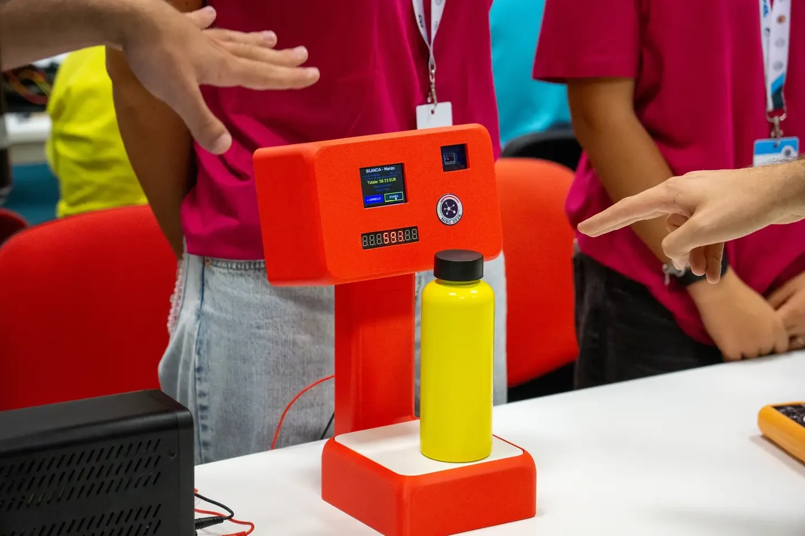

<div align="center">


<br /><br />


<h3>Bilancia Intelligente 100% Touchless — Pagina Prodotto 3D Interattiva</h3>

<p>
  <strong>1° Premio · NeaPolis Innovation Summer Campus (NISC 2026) · STMicroelectronics</strong><br />
  <em>Questa repository contiene il codice sorgente del sito web ufficiale interattivo 3D di PONDULO.</em>
</p>

<p>
  <a href="https://pondulo.vincenzonet.it">
    
  </a>
  <a href="https://www.vincenzonet.it/pondulo-bilancia-touchless-nisc-2026/">
    
  </a>
  <a href="https://github.com/EmanuelChirico/Pondulo">
    
  </a>
  <a href="https://www.pepite.info/blog/neapolis-innovation-summer-campus-2026-i-vincitori/#:~:text=Team%206%3A%20%E2%80%9CPONDULO%E2%80%9D">
    
  </a>
</p>

<br />



</div>

---

## Link Rapidi del Progetto

| Risorsa | Descrizione | Link |
|---|---|---|
| **Sito Web 3D Ufficiale** | Esperienza scrollytelling 3D interattiva con esploso, Raggi X e Inspector 360° | [**pondulo.vincenzonet.it**](https://pondulo.vincenzonet.it) |
| **Articolo sul Portfolio** | Presentazione completa, progettazione Fusion 360 e suite di tutti i chip utilizzati | [**vincenzonet.it/pondulo-bilancia-touchless-nisc-2026**](https://www.vincenzonet.it/pondulo-bilancia-touchless-nisc-2026/) |
| **Codice Firmware Ufficiale** | Sorgenti completi per le 3× STM32 NUCLEO-G474RE (ChibiOS/RT, uGFX, VL53L7CX, HX711) ed ESP8266 | [**github.com/EmanuelChirico/Pondulo**](https://github.com/EmanuelChirico/Pondulo) |
| **Articolo Vincitori ST** | Riconoscimento ufficiale del Team 6 sul portale Pepite di STMicroelectronics | [**pepite.info — NISC 2026 I Vincitori**](https://www.pepite.info/blog/neapolis-innovation-summer-campus-2026-i-vincitori/#:~:text=Team%206%3A%20%E2%80%9CPONDULO%E2%80%9D) |

---

## Cos'è PONDULO

**PONDULO** è una bilancia intelligente **completamente touchless** pensata per ambienti clinici, alimentari e chimici, dove eliminare il contatto fisico con tastiere e touchscreen condivisi riduce drasticamente il rischio di contaminazione crociata e protegge la catena sterile.

L'intera interfaccia (doppia modalità **Macelleria** e **Clinico**) si controlla muovendo la mano nell'aria davanti a un sensore laser **dToF 8×8 (`VL53L7CX`)**, con puntatore *air-cursor*, conferma *dwell* (1,5 s), *air-swipe* e feedback acustico dedicato.

---

## Cosa include questo sito web 3D (`coperleo/pondulo`)

- **Modello 3D reale (`assets/pondulo.glb`)**: derivato dal CAD originale progettato in **Autodesk Fusion 360** (`.3mf` multi-parte) arricchito con elettronica interna 3D, schermi illuminati (TFT `ILI9341` + 7-segmenti rosso) e adesivo circolare `NISC 2026`.
- **Carosello Scrollytelling a 12 capitoli** (*Three.js r169 + GSAP ScrollTrigger*):
  - Animazione reale della **testa basculante** attorno al vincolo rotativo CAD;
  - Proiezione volumetrica del **fascio laser ToF 8×8 (940 nm VCSEL)**;
  - Modalità **Raggi X automatica** con contorni CAD `EdgesGeometry`;
  - **Esploso 3D a zero collisioni** di tutti i 13 sottosistemi con etichette anti-sovrapposizione e linee guida SVG;
  - **Inspector Libero 360°** con slider *Esploso*, *Inclinazione Testa*, *Raggi X*, *Fascio ToF* e *OrbitControls*.
- **Demo Live & Architettura**: video reale acquisito durante l'HackFest, schema dei bus distribuiti, scenari applicativi interattivi e roadmap evolutiva verso PONDULO 2.0.

---

## Architettura Hardware (Tri-Nucleo STM32 + Wi-Fi)

| Sottosistema | Componenti principali | Bus / Protocollo |
|---|---|---|
| **Scheda A · Sensing ToF** | `NUCLEO-G474RE` + `X-NUCLEO-53L7A1` (`VL53L7CX` 8×8 dToF) | `I²C1 1 MHz FM+` → `USART3 921.600 baud` (`$XY`/`$GS`) |
| **Scheda B · Hub HMI & Audio** | `NUCLEO-G474RE` + `X-NUCLEO-GFX01M2` (`ILI9341` 2.2" uGFX) | `SPI` (mutex `gdisp`), `UART5 9600` (`YX5300`), `ADC2 PA4` |
| **Scheda C · Metrologia & LED** | `NUCLEO-G474RE` + Cella di carico + `HX711` 24-bit + `2× 74HC595` / `CL3641BH` | `SPI1` display 8 cifre → ponte analogico `DAC1 PA4 → ADC2 PA4` |
| **Connettività IoT** | `ESP8266` (Web Server HTTP + persistenza atomica `LittleFS`) | `UART1 38.400 baud` (`PRODUCT_ADD` / `PRODUCT_CODE`) |
| **Audio & Alimentazione** | `YX5300` Serial MP3 + Amplificatore + Speaker 45 mm + Buck `LM2596` | `12 V DC → 5 V` regolati, massa comune |

---

## Anteprima in locale

Trattandosi di un sito statico puro (HTML/CSS/JS + GLB), per eseguirlo in locale è sufficiente un qualsiasi server HTTP statico:

```bash
python -m http.server 8765
# Apri nel browser: http://localhost:8765/
```

---

## Team 6 — NISC 2026 (ordine alfabetico)

Progetto sviluppato durante la 13ª edizione del **NeaPolis Innovation Summer Campus** (STMicroelectronics):

- **Alessia Giamundo** — Università di Napoli Federico II
- **Emanuel Chirico** — Università degli Studi di Salerno · [Sito](https://emanuelchirico.github.io/) · [GitHub](https://github.com/EmanuelChirico) · [LinkedIn](https://www.linkedin.com/in/emanuel-chirico-11946a395/)
- **Federico Longobardi** — Università degli Studi di Trento · [LinkedIn](https://www.linkedin.com/in/federico-longobardi-8a5594290)
- **Gianluigi Esposito** — Università di Napoli Federico II · [LinkedIn](https://www.linkedin.com/in/gianluigi-esposito-a3910a229)
- **Lucia Cerullo** — Università di Napoli Federico II
- **Matteo Saccone** — Università di Napoli Federico II · [LinkedIn](https://www.linkedin.com/in/matteo-saccone/)
- **Vincenzo D’Ambrosio** — Università della Campania "Luigi Vanvitelli" · [Sito](https://www.vincenzonet.it) · [GitHub](https://github.com/coperleo) · [LinkedIn](https://www.linkedin.com/in/vincenzo-d-ambrosio-coperleo/)

### Tutor del Team 6 (Ringraziamento speciale)

Un ringraziamento speciale al nostro tutor che ci ha seguito e aiutato nella realizzazione del progetto durante il NISC 2026:

- **Agostino Vallefuoco** — Tutor Team 6 · [LinkedIn](https://www.linkedin.com/in/agostino-vallefuoco-127195291/)
